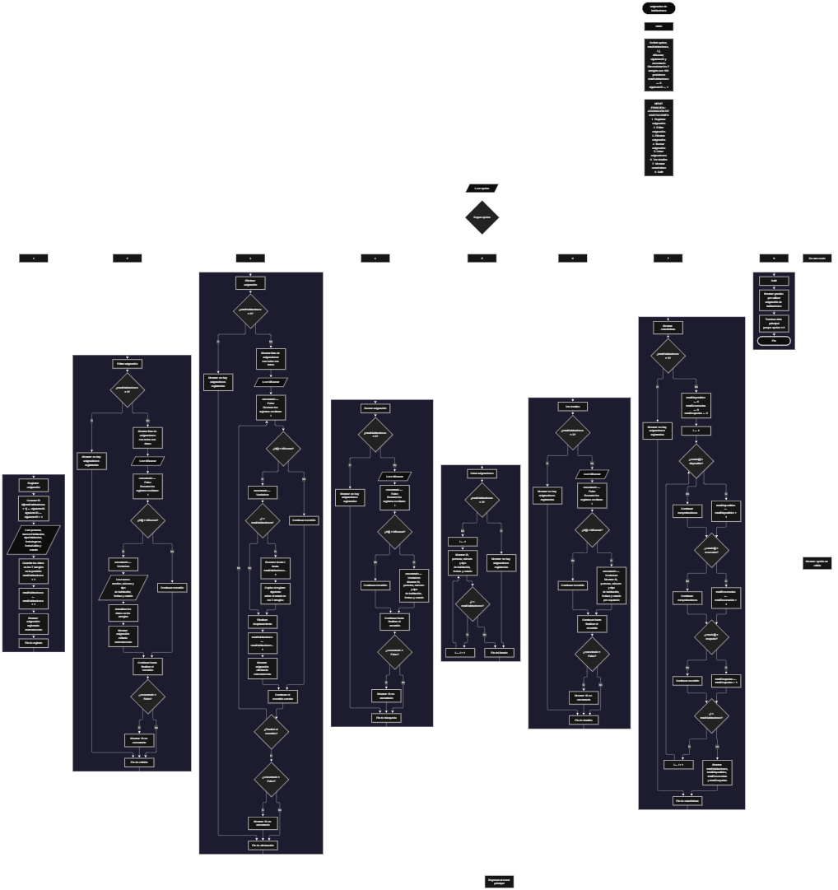

 

Este proyecto, llamado <b>asignación de habitaciones</b>, fue desarrollado en <b>pseint</b> como un ejercicio práctico para fortalecer la lógica de programación mediante la creación de un sistema de gestión de asignaciones de habitaciones desde la consola. El programa cuenta con un menú principal de ocho opciones que permite <b>registrar, editar, eliminar, buscar, listar y consultar los detalles de las asignaciones, además de mostrar estadísticas generales</b>. Cada asignación almacena datos como el nombre de la persona, el número y tipo de habitación, las fechas de ingreso y salida, y el estado de la habitación, utilizando arreglos con una capacidad declarada de <b>100 registros durante la ejecución</b>. Durante su desarrollo se aplicaron conceptos fundamentales de programación, como variables, arreglos paralelos, estructuras condicionales, ciclos repetitivos y estructuras de selección, además de procesos para buscar, modificar, eliminar y organizar registros. Este proyecto permite poner en práctica los conocimientos adquiridos en PSeInt y sirve como base para desarrollar sistemas de gestión más avanzados utilizando otros lenguajes y tecnologías.

<h2 align="center">⚙️ Funcionamiento del menú principal</h2>

### ➕ Registrar asignación

La opción <b>1) registrar asignación</b> permite registrar una nueva asignación de habitación. Al comenzar, el programa utiliza la variable <b>siguienteID</b> para generar un identificador único dentro de la secuencia de registros y lo almacena en el arreglo <b>id</b>, en la siguiente posición disponible. Después, incrementa <b>siguienteID</b> en uno y solicita el <b>nombre de la persona, número de habitación, tipo de habitación, fecha de ingreso, fecha de salida y estado</b>. Los datos se almacenan en sus respectivos arreglos, utilizando la misma posición para relacionar toda la información de una asignación. Finalmente, aumenta la variable <b>totalHabitaciones</b> en uno y muestra el mensaje <b>"asignacion registrada correctamente."</b>. En el código actual no se comprueba si los 100 espacios de los arreglos están ocupados ni se valida que los datos introducidos sean correctos.

### ✏️ Editar asignación

La opción <b>2) editar asignación</b> permite modificar la información de una habitación asignada. Primero, el programa comprueba si la variable <b>totalHabitaciones</b> es igual a <b>0</b>. Si no existen registros, muestra el mensaje <b>"no hay asignaciones registradas."</b>. En caso contrario, presenta una lista con el ID, la persona, el número y tipo de habitación, las fechas de ingreso y salida, y el estado de cada asignación. Después, solicita el ID de la asignación que se desea editar y utiliza la variable lógica <b>encontrado</b>, inicializada en <b>falso</b>, para controlar el resultado de la búsqueda. Mediante un ciclo <b>para</b>, recorre los registros y compara cada identificador con el valor introducido. Si encuentra una coincidencia, cambia <b>encontrado</b> a <b>verdadero</b> y solicita los nuevos datos de la persona, el número y tipo de habitación, las fechas y el estado, actualizando los arreglos correspondientes. Finalmente, muestra el mensaje <b>"asignacion editada correctamente."</b>. Si el ID no coincide con ningún registro, presenta el mensaje <b>"no se encontró una asignacion con ese id."</b>.

### 🗑️ Eliminar asignación

La opción <b>3) eliminar asignación</b> permite eliminar una asignación registrada mediante su ID. Antes de comenzar, el programa comprueba si existen registros. Si no hay asignaciones, muestra el mensaje <b>"no hay asignaciones registradas."</b>. Si existen datos, presenta una lista con la información de las asignaciones y solicita el ID que se desea eliminar. Después, inicializa la variable lógica <b>encontrado</b> con el valor <b>falso</b> y recorre el arreglo <b>id</b> mediante un ciclo <b>para</b>. Cuando encuentra el identificador solicitado, cambia la variable a <b>verdadero</b>. Si la posición encontrada es menor que <b>totalHabitaciones</b>, utiliza un segundo ciclo <b>para</b>, controlado por la variable <b>j</b>, para desplazar una posición hacia la izquierda los datos posteriores en los siete arreglos: <b>id, persona, numeroHabitacion, tipoHabitacion, fechaIngreso, fechaSalida y estado</b>. A continuación, disminuye <b>totalHabitaciones</b> en uno y muestra el mensaje <b>"asignacion eliminada correctamente."</b>. En el código actual, el ciclo exterior continúa después de eliminar el registro y modificar el contador, por lo que el recorrido puede omitir algún registro desplazado o comportarse de manera inesperada. Además, no se limpia explícitamente la última posición que deja de formar parte de los registros activos.

### 🔎 Buscar asignación

La opción <b>4) buscar asignación</b> permite localizar una asignación mediante su identificador. Primero, el programa comprueba si existen registros almacenados. Si <b>totalHabitaciones</b> es igual a <b>0</b>, muestra el mensaje <b>"no hay asignaciones registradas."</b>. En caso contrario, solicita el ID de la asignación que se desea buscar e inicializa la variable lógica <b>encontrado</b> con el valor <b>falso</b>. A continuación, utiliza un ciclo <b>para</b> para recorrer los identificadores almacenados y compararlos con el valor introducido mediante la condición <b>id[i] = idBuscar</b>. Cuando encuentra una coincidencia, cambia la variable a <b>verdadero</b> y muestra el ID, el nombre de la persona, el número y tipo de habitación, las fechas de ingreso y salida, y el estado. Si termina el recorrido sin encontrar coincidencias, presenta el mensaje <b>"no se encontró una asignacion con ese id."</b>. La búsqueda se realiza mediante el ID y no mediante el nombre de la persona o el número de habitación.

### 📋 Listar asignaciones

La opción <b>5) listar asignaciones</b> permite visualizar todos los registros almacenados en el sistema. Antes de mostrar la información, el programa comprueba si la variable <b>totalHabitaciones</b> es igual a <b>0</b>. Si no existen asignaciones, presenta el mensaje <b>"no hay asignaciones registradas."</b>. Si hay registros disponibles, muestra el encabezado <b>"datos registrados"</b> y utiliza un ciclo <b>para</b> para recorrer los arreglos desde la primera posición hasta la cantidad total de asignaciones. Durante el recorrido, presenta el ID, la persona, el número y tipo de habitación, las fechas de ingreso y salida, y el estado de cada registro. Esta opción facilita consultar las asignaciones existentes sin necesidad de buscar cada una individualmente.

### 📄 Ver detalles de la asignación

La opción <b>6) ver detalles</b> permite consultar individualmente toda la información de una asignación. Primero, el programa comprueba si existen registros. Si la variable <b>totalHabitaciones</b> es igual a <b>0</b>, muestra el mensaje <b>"no hay asignaciones registradas."</b>. En caso contrario, solicita el ID de la asignación que se desea consultar e inicializa <b>encontrado</b> con el valor <b>falso</b>. Después, recorre los identificadores mediante un ciclo <b>para</b> y compara cada uno con el valor introducido. Si encuentra una coincidencia, cambia la variable a <b>verdadero</b> y muestra los detalles por separado: <b>ID, persona, número de habitación, tipo de habitación, fecha de ingreso, fecha de salida y estado</b>. Si no encuentra el identificador solicitado, presenta el mensaje <b>"no se encontró una asignacion con ese id."</b>. Esta opción permite consultar la información de una asignación de forma más detallada que el listado general.

### 📊 Mostrar estadísticas

La opción <b>7) mostrar estadísticas</b> permite obtener un resumen de las asignaciones registradas según el estado de las habitaciones. Primero, el programa comprueba si <b>totalHabitaciones</b> es igual a <b>0</b>. Si no existen registros, muestra el mensaje <b>"no hay asignaciones registradas."</b>. Si hay asignaciones, inicializa las variables <b>totalDisponibles, totalReservadas y totalOcupadas</b> en cero. A continuación, utiliza un ciclo <b>para</b> para recorrer los registros y comparar el contenido de <b>estado[i]</b> con las cadenas <b>"disponible"</b>, <b>"reservada"</b> y <b>"ocupada"</b>. Cada coincidencia incrementa el contador correspondiente en uno. Al finalizar, muestra el total de habitaciones registradas, la cantidad disponible, la cantidad reservada y la cantidad ocupada. Los conteos dependen de que el estado almacenado coincida exactamente con las cadenas comparadas, por lo que otros valores o diferencias en mayúsculas y minúsculas no se contabilizan en esas categorías.

### 🚪 Salir del menú principal

La opción <b>8) salir</b> permite finalizar el programa y muestra el mensaje <b>"gracias por utilizar asignacion de habitaciones."</b>. El menú principal se encuentra dentro de una estructura repetitiva <b>repetir ... hasta que</b>, que mantiene el programa en funcionamiento mientras el usuario realiza las operaciones disponibles. En el código actual, la condición final es <b>hasta que opcion = 8</b>, que coincide con la opción de salida presentada en el menú. Por este motivo, después de seleccionar la opción 8, el ciclo termina y la ejecución del algoritmo finaliza.

<h2 align="center">🧠 Temas aplicados en el proyecto</h2>

### 📦 Variables

En este proyecto se utilizan variables para controlar la opción seleccionada en el menú, contar las asignaciones registradas, recorrer los arreglos, almacenar el ID que se desea localizar, generar nuevos identificadores y comprobar si se encuentra un registro. También se utilizan contadores para calcular las estadísticas de las habitaciones disponibles, reservadas y ocupadas. Cada variable cumple una función específica dentro de las operaciones de gestión de asignaciones.

🔢 **Opcion:** Almacena la opción seleccionada por el usuario en el menú principal.

📊 **TotalHabitaciones:** Almacena la cantidad actual de asignaciones registradas.

🔄 **I:** Funciona como contador en los ciclos <b>para</b> y permite recorrer las posiciones de los arreglos.

🔁 **J:** Controla el recorrido utilizado para desplazar los datos de las asignaciones posteriores durante la eliminación.

🔎 **IdBuscar:** Almacena el identificador introducido por el usuario para buscar, editar, eliminar o consultar una asignación.

🆔 **SiguienteID:** Genera el identificador de la siguiente asignación que se registre, comenzando en <b>1</b> e incrementándose después de cada registro.

✅ **Encontrado:** Variable lógica que indica si se localizó una asignación con el ID solicitado.

📊 **TotalDisponibles:** Cuenta las asignaciones cuyo estado es exactamente <b>"disponible"</b>.

📊 **TotalReservadas:** Cuenta las asignaciones cuyo estado es exactamente <b>"reservada"</b>.

📊 **TotalOcupadas:** Cuenta las asignaciones cuyo estado es exactamente <b>"ocupada"</b>.

### 🗃️ Arreglos

En este proyecto se utilizan siete arreglos paralelos para almacenar la información de las asignaciones. Cada arreglo está dimensionado para <b>100 posiciones</b> y utiliza el mismo índice para relacionar los datos correspondientes a una misma asignación. Por ejemplo, la información del registro almacenado en la posición <b>1</b> se encuentra distribuida entre <b>id[1], persona[1], numeroHabitacion[1], tipoHabitacion[1], fechaIngreso[1], fechaSalida[1] y estado[1]</b>. Esta organización permite recorrer, buscar, modificar, mostrar y eliminar las asignaciones utilizando una posición común. Aunque se declaran 100 posiciones, el programa no contiene una comprobación explícita que impida registrar datos cuando se alcanza esa capacidad.

🆔 **Id[100]:** Almacena los identificadores de las asignaciones registradas.

👤 **Persona[100]:** Almacena los nombres de las personas relacionadas con las habitaciones.

🚪 **NumeroHabitacion[100]:** Almacena los números de las habitaciones asignadas.

🏠 **TipoHabitacion[100]:** Almacena el tipo de habitación correspondiente a cada asignación.

📅 **FechaIngreso[100]:** Almacena las fechas de ingreso de las personas.

📅 **FechaSalida[100]:** Almacena las fechas de salida de las personas.

📌 **Estado[100]:** Almacena el estado de cada habitación, como disponible, reservada u ocupada.

### 🔀 Estructuras condicionales

En este proyecto se utilizan las estructuras <b>si</b> y <b>sino</b> para comprobar si existen asignaciones registradas antes de realizar las operaciones, determinar si el ID introducido coincide con alguno de los identificadores almacenados y decidir si se deben desplazar los registros durante una eliminación. También se utilizan condiciones para comparar el estado de cada habitación y calcular las estadísticas. Estas estructuras permiten que el programa responda de manera diferente según la cantidad de registros, el resultado de una búsqueda y los valores almacenados en los arreglos.

### 🔄 Estructuras repetitivas

En este proyecto se utilizan los ciclos <b>para</b> y <b>repetir ... hasta que</b>. Los ciclos <b>para</b> permiten recorrer los arreglos para mostrar las asignaciones, buscar un ID, editar datos, consultar detalles y calcular las estadísticas. Durante la eliminación, un ciclo adicional desplaza los datos de los registros posteriores una posición hacia la izquierda. Por otro lado, el ciclo <b>repetir ... hasta que</b> mantiene activo el menú principal para que el usuario pueda ejecutar distintas operaciones hasta seleccionar la opción <b>8</b>, que finaliza el programa.

### 🎯 Estructura según

El programa evalúa el valor almacenado en la variable <b>opcion</b> mediante la estructura <b>segun ... hacer</b> y ejecuta el bloque de instrucciones correspondiente. Cada caso representa una operación específica del sistema: <b>registrar, editar, eliminar, buscar, listar, ver detalles, mostrar estadísticas o salir</b>. También se utiliza el bloque <b>de otro modo</b> para mostrar el mensaje <b>"opcion no valida."</b> cuando el usuario introduce un número que no coincide con ninguna de las opciones definidas en el menú.

### 🔢 Dimensionamiento de arreglos

El programa utiliza la instrucción <b>dimension</b> para establecer la capacidad de los siete arreglos que almacenan los datos de las asignaciones. Cada arreglo dispone de <b>100 posiciones</b>. La variable <b>totalHabitaciones</b> controla cuántas asignaciones se consideran registradas durante la ejecución, por lo que los recorridos utilizan las posiciones comprendidas entre la primera y la cantidad total de registros. Sin embargo, el código actual no comprueba si existe espacio disponible antes de agregar una nueva asignación.

### 🔄 Reorganización de registros

Cuando se elimina una asignación, el programa utiliza el ciclo <b>para</b> controlado por <b>j</b>, que comienza en la posición seleccionada y llega hasta <b>totalHabitaciones - 1</b>. En cada repetición, los datos de la posición siguiente se copian sobre la posición actual en los siete arreglos: <b>id, persona, numeroHabitacion, tipoHabitacion, fechaIngreso, fechaSalida y estado</b>. Después, la variable <b>totalHabitaciones</b> disminuye en uno. Este procedimiento busca mantener juntos los datos de cada asignación y evitar espacios intermedios entre los registros activos. No obstante, el ciclo exterior continúa ejecutándose después de modificar el contador, y la última posición que deja de estar activa no se limpia explícitamente.

<h2 align="center">¿Cómo se implementaron las operaciones crud en el proyecto?</h2>

Las operaciones <b>crud</b> se implementaron mediante las opciones del menú principal, permitiendo administrar las asignaciones registradas. La operación <b>crear</b> corresponde a <b>registrar asignación</b>, donde se genera un ID y se introducen los datos de una nueva habitación; <b>leer</b> se realiza mediante las opciones <b>buscar asignación, listar asignaciones y ver detalles</b>; <b>actualizar</b> corresponde a <b>editar asignación</b>, donde se modifican los datos de un registro existente; y <b>eliminar</b> se realiza mediante la opción <b>eliminar asignación</b>. Estas operaciones utilizan variables, arreglos paralelos, condiciones y ciclos para gestionar la información almacenada temporalmente durante la ejecución del programa. La opción de estadísticas complementa estas operaciones al contar las asignaciones según el estado registrado.

<h2 align="center">Diagrama de flujo del proyecto</h2>

<h2 align="center">🛡️ Validaciones del programa</h2>

### 📭 No existen asignaciones registradas

Esta comprobación se utiliza en las opciones de <b>editar, eliminar, buscar, listar, ver detalles y mostrar estadísticas</b>. El programa verifica si la variable <b>totalHabitaciones</b> es igual a <b>0</b> y, si no existen asignaciones registradas, muestra el mensaje <b>"no hay asignaciones registradas."</b>. Esta condición evita continuar con las operaciones que necesitan datos almacenados cuando la lista está vacía.

### ❌ Asignación no encontrada

Esta comprobación se utiliza en las operaciones de <b>editar, eliminar, buscar y ver detalles</b>. El programa inicializa la variable lógica <b>encontrado</b> con el valor <b>falso</b> y recorre el arreglo <b>id</b> para comparar los identificadores con el valor introducido por el usuario. Cuando encuentra una coincidencia, cambia la variable a <b>verdadero</b> y ejecuta la operación correspondiente. Si al finalizar el recorrido la variable continúa siendo <b>falso</b>, muestra el mensaje <b>"no se encontró una asignacion con ese id."</b>. Esta comprobación permite informar al usuario cuando no existe un registro con el identificador solicitado.

### 📊 Clasificación por estado

La opción de estadísticas compara el contenido del arreglo <b>estado</b> con las cadenas <b>"disponible"</b>, <b>"reservada"</b> y <b>"ocupada"</b>. Cada coincidencia incrementa el contador correspondiente. Sin embargo, el programa no valida el estado introducido durante el registro o la edición. Por esta razón, si se escribe un valor diferente o una variante con mayúsculas, ese registro no se contabiliza dentro de las categorías reconocidas por las condiciones.

### ⚠️ Capacidad de los arreglos

Los siete arreglos se dimensionan para almacenar <b>100 posiciones</b>. Sin embargo, el código actual no incluye una condición que compruebe si <b>totalHabitaciones</b> es menor que <b>100</b> antes de registrar una nueva asignación. Por lo tanto, aunque existe una capacidad declarada, el programa no impide explícitamente que se intente registrar información por encima de las posiciones disponibles.

### ⚠️ Datos de la asignación

Durante el registro y la edición, el programa solicita el nombre de la persona, el número y tipo de habitación, las fechas de ingreso y salida, y el estado. Sin embargo, no incluye comprobaciones específicas para verificar que las fechas sean válidas, que la fecha de salida sea posterior a la de ingreso, que el número de habitación sea único o que el estado pertenezca a las categorías permitidas. Los datos se almacenan tal como los introduce el usuario, y las estadísticas solo reconocen los tres estados comparados explícitamente en el código.

### ⚠️ Opción inválida

La estructura <b>segun</b> incluye el bloque <b>de otro modo</b>, que muestra el mensaje <b>"opcion no valida."</b> cuando el usuario introduce un número que no corresponde a ninguna de las opciones definidas en el menú. Esta respuesta permite informar que la selección no coincide con las operaciones disponibles, mientras el ciclo principal continúa hasta que se selecciona la opción <b>8</b>.

<h2 align="center">🎯 Objetivo del proyecto</h2>

El objetivo principal de este proyecto es fortalecer la <b>lógica de programación</b> mediante el desarrollo de un sistema de asignación de habitaciones en <b>pseint</b>. A través de su construcción se busca aplicar los conocimientos adquiridos sobre variables, arreglos paralelos, estructuras condicionales, ciclos repetitivos y estructuras de selección, integrándolos para resolver un problema de manera organizada. Además, el proyecto permite comprender cómo registrar, consultar, modificar, eliminar y clasificar información en una aplicación de consola, estableciendo una base para desarrollar sistemas de gestión de habitaciones más completos utilizando otros lenguajes y tecnologías.

